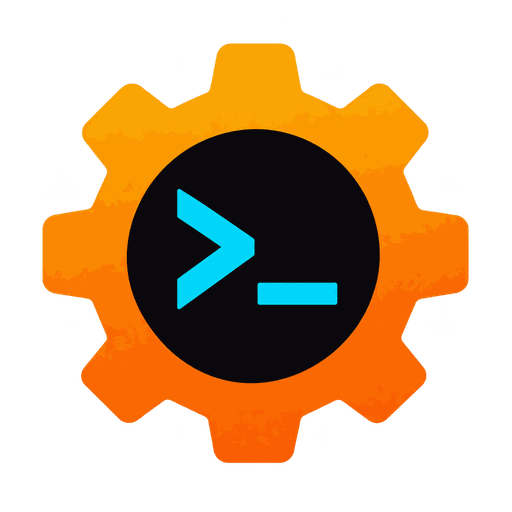
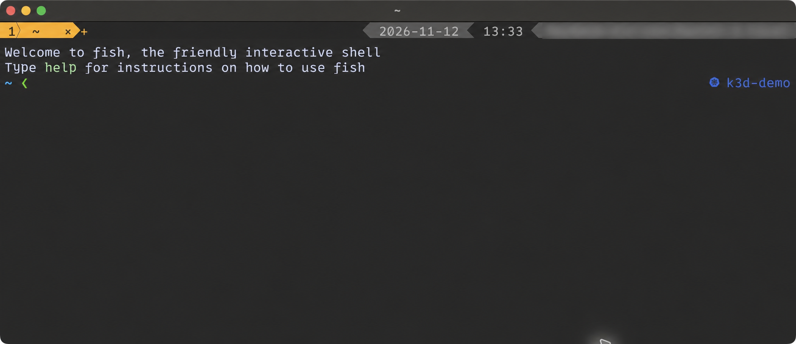
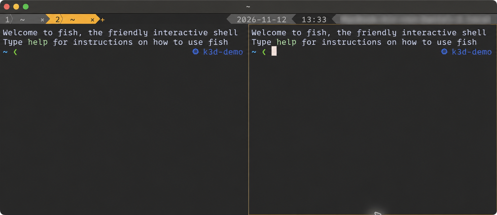

<p align="center">
  
</p>

<h1 align="center">rst</h1>
<p align="center"><strong>Rust Simple Terminal</strong></p>

A native terminal for **macOS** and **Linux/Wayland**, written in Rust.
Built-in tabs, nested splits and a compact status bar keep your shells in one
window, with quick keyboard navigation and no heavyweight GUI framework.

## The bar

Dynamic-width tabs sit on the left; date, local time and hostname sit on the
right. Arrow segments connect the fields, and the active tab is highlighted in
amber. Tab names follow the running program or working directory. Click a tab
to focus it, **+** to open one, or **×** to close the whole tab and its panes.



Each tab can contain up to **8 independent panes**, split left/right or top/bottom.
Expand one pane to fill the terminal while its siblings become subtle accordion
folds; press the same shortcut again to restore the layout.




## Shortcuts

| Action | macOS | Linux / Wayland |
| --- | --- | --- |
| New tab | **Cmd+T** | **Ctrl+Shift+T** |
| Next / previous tab | **Ctrl+Tab / Ctrl+Shift+Tab** | Same |
| Select tab 1–9 | **Cmd+1…9** | **Alt+1…9** |
| Split left / right | **Cmd+D** | **Ctrl+Shift+D** |
| Split top / bottom | **Cmd+Shift+D** | **Ctrl+Shift+E** |
| Focus neighboring split | **Cmd+Shift+Arrow** | **Ctrl+Shift+Arrow** |
| Expand pane / restore splits | **Cmd+Shift+F** | **Ctrl+Shift+F** |
| Close focused pane / last tab | **Cmd+W** | **Ctrl+Shift+W** |
| Copy / paste | **Cmd+C / Cmd+V** | **Ctrl+Shift+C / Ctrl+Shift+V** |
| Copy last command's output | **Cmd+Shift+O** | **Ctrl+Shift+O** |
| Browse URLs from recent output | **Cmd+Shift+U** | **Ctrl+Shift+U** |
| Increase / decrease font | **Cmd++ / Cmd+-** | **Ctrl++ / Ctrl+-** |
| Reset font size | **Cmd+0** | **Ctrl+0** |
| Scroll history | **Shift+PgUp / PgDn** | Same |
| Keyboard help | **F1** or **Cmd+Shift+H** | **F1** or **Ctrl+Shift+H** |

Click inside a split to focus it. **Cmd+Option+Arrow** also works on macOS.
Double-click selects a word; triple-click selects a line. **Option/Alt+drag**
selects a rectangle, and **Shift+mouse** selects text inside mouse-aware apps.
The URL picker uses **j/k** or arrows, **Enter** to open, and **Esc** to close.

## Get started

Install [Rust](https://rustup.rs/), then:

```sh
git clone https://github.com/dme86/rst.git
cd rst
make run
```

`make run` opens a native macOS app or runs directly on Wayland. New terminals
use `$SHELL`, falling back to `/bin/sh`. Use `rst -e PROGRAM [ARGS...]` to launch
a specific program.

For an optimized build, use `make macos-release` on macOS or `make release` on
Linux. Install with `make install-macos` or `make install`, respectively.
On macOS, build bundles are named **rst Debug** / **rst Preview** and have
separate app identifiers, so Spotlight cannot confuse them with the installed
**rst**. `make install-macos` also migrates an existing debug bundle to its own
identity. Bundles are locally ad-hoc signed, but are not Developer ID signed or
notarized.

## Configure

Create `~/.config/rst/config.toml` (or `$XDG_CONFIG_HOME/rst/config.toml`).
All settings are optional; the bar and workspace restoration are off by default.

```toml
[tabs]
enabled = true
position = "top"       # "top" or "bottom"
powerline = true      # arrow-shaped segments
show_status = true    # date, time and hostname
name_mode = "smart"   # program → directory → title → shell

[terminal]
shell = ""            # empty: $SHELL, then /bin/sh
shell_args = []       # e.g. ["-l"] for a login shell

[window]
startup_mode = "windowed" # "windowed", "maximized" or "fullscreen"
decorations = true    # false hides the native title bar / border

[session]
restore = false       # true restores the workspace on the next launch
```

See [`config/default.toml`](config/default.toml) for fonts, colors, scrollback,
clipboard and other settings. Set `terminal.shell` to an executable such as
`/opt/homebrew/bin/fish`, `/bin/zsh` or `/usr/bin/fish`; pass arguments separately
in `shell_args`. It applies to initial shells, tabs, splits and restored panes;
`rst -e PROGRAM ...` still runs the explicit program. Restart rst after changes.
In `windowed` mode, `columns` and `rows` set the initial size; `maximized` fills
the available desktop, while `fullscreen` uses borderless fullscreen.
Without decorations, drag free tab-bar space or the status area to move the
window; Wayland window borders remain subject to compositor policy.

**Workspace restoration** saves tabs, split layouts, focus and known working
directories locally on macOS and Linux. After a restart or reboot, they reopen
with **fresh shells**. Running programs, scrollback and shell variables are not
preserved, and computers do not synchronize automatically. The file lives at
`$XDG_STATE_HOME/rst/session.toml`, falling back to
`~/.local/state/rst/session.toml`. Multiple windows share it; the last saved
workspace wins. Explicit `rst -e ...` launches leave it alone.

## Shell integration

For working-directory detection and copying a command's output without its
prompt, install the bundled fish, zsh and bash hooks once:

```sh
make shell-integration
# Or, with rst already installed:
rst --install-shell-integration
```

This adds source hooks to the shell configuration files; normal startup does
not change them. Open a new rst window afterwards. Remote shells need their
own integration. Command-output capture is bounded (32 MiB by default).

## Development

```sh
make test
make lint
make release
```

See [performance testing](docs/performance-testing.md) and
[rendering notes](docs/rendering.md). rst is under active development; terminal
resizing does not yet provide full text reflow. Linux requires Wayland, and
clipboard support depends on the compositor's data-control support.

[MIT license](LICENSE).
